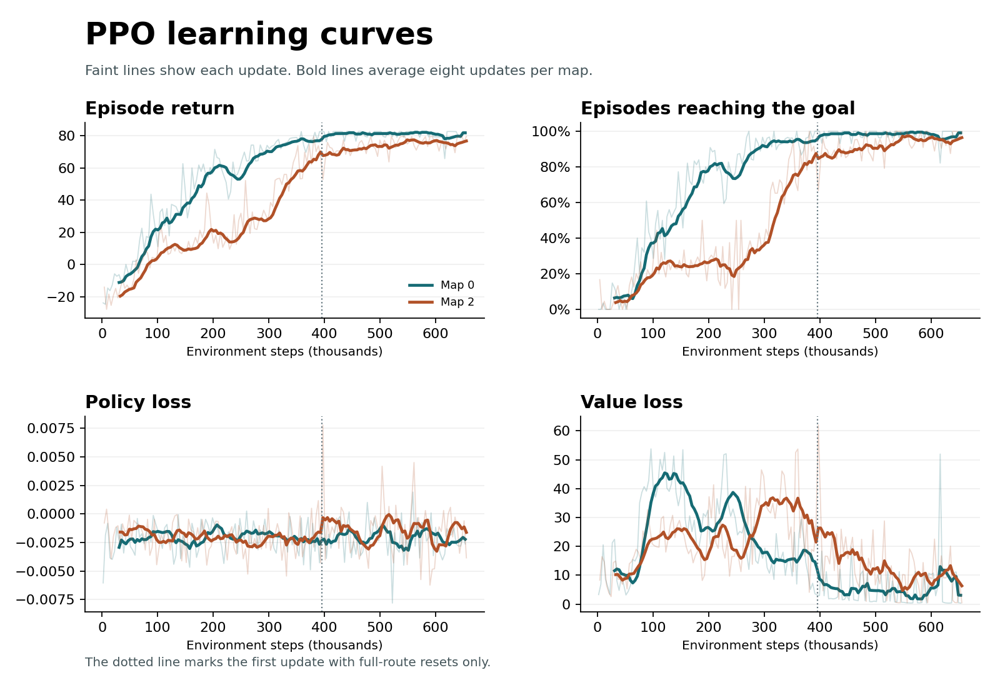

# Assignment 2 · Teaching the taxi to drive with PPO

**Author: Sabina Yamilova · Innopolis University · IAEML**

The final policy reached the destination in 192 of 192 held-out episodes. A random driver reached it in 0 of 192 paired episodes. An earlier policy trained on one map crashed in all 64 attempts on map 2. This report describes what changed between those experiments. [Final checkpoint](../checkpoints/ppo.msgpack) · [Recorded policy](../videos/trained_agent_demo.mp4)

## Experimental setup

Each episode starts with a stationary car. The reset key changes the initial heading by up to 0.25 rad and gives moving obstacles a common time offset between 0 and 6 seconds. During final training the rollouts alternate between maps 0 and 2. Each map keeps its own 32 environment states while both update one network. Map 1 is reserved for evaluation. It shares the start, goal and much of the layout of map 0.

Early training also uses shorter routes. A safe intermediate waypoint can become the starting position, with the car facing along the route. The probability of attempting a short start begins at 0.65 and reaches zero after 60% of the updates. Every evaluation and video starts from the original course start. No controller actions or demonstrations are used in training.

| Setting | Final run |
|---|---|
| Hardware and software | One JAX CPU device, Python 3.12.14, JAX 0.7.2, Flax 0.11.2 and Optax 0.2.6 |
| Training seed | 7 |
| Rollout | 32 environments × 64 steps = 2,048 transitions per update |
| Budget | 320 updates = 655,360 transitions, 160 updates per training map |
| Optimizer | Adam, learning rate 0.00035, epsilon 0.00001, global gradient norm limit 0.5 |
| PPO update | 4 epochs, 4 shuffled minibatches per epoch, 512 samples in each minibatch |
| Discount and GAE | $\gamma=0.99$, $\lambda=0.95$ |
| Loss settings | PPO clip 0.2, value coefficient 0.5, entropy coefficient 0.003 |

A smoke test used 128 transitions across two tiny rollouts. It produced finite losses and two finite actions after reloading the weights. No episode finished in that short test. The full run recorded 7,682 completed training episodes. Its update loop, including compilation of both map-specific updates, took 21.2 seconds on the recorded host. This timer excludes installation, environment setup, evaluation and rendering. Timings and outcomes from other machines can vary. [Smoke log](../results/smoke/run.json) · [Full configuration](../results/training/run.json) · [Update log](../results/training/updates.csv)

## RL model

The actor and critic receive the same 25 numbers. Each has two dense layers of 64 tanh units. The actor produces two Gaussian means and learns one log standard deviation for each action. Training samples two values and applies tanh to get a pedal request and a steering request in [-1, 1]. Evaluation uses the tanh of the mean. The critic produces a single estimate of the discounted reward ahead.

PPO first drives with the current policy and records the action probabilities. It estimates an advantage for every action from the rewards and critic values. A positive advantage says that this action performed better than the critic expected. The update compares the new and old probabilities of the same action. The clipped objective limits the incentive to change this ratio too far in one update. The critic learns the return targets with squared error. An entropy bonus encourages exploration. [PPO, Schulman et al.](https://arxiv.org/abs/1707.06347) · [Spinning Up explanation](https://spinningup.openai.com/en/latest/algorithms/ppo.html)

GAE combines short and longer estimates of this advantage. The next value is zeroed for a goal or collision. At the time limit the bootstrap uses the final observation before reset. In both cases the advantage trace stops at the episode boundary. Advantages are normalized across the rollout before a minibatch update. [GAE, Schulman et al.](https://arxiv.org/abs/1506.02438)

The rollout stores the Gaussian sample before tanh. For that same sample, the tanh Jacobian cancels in the probability ratio. For entropy it matters, so the code estimates the entropy of the bounded policy using a fresh sample and a stable log-Jacobian. Flax supplies the layers and checkpoint serialization. Optax supplies Adam and gradient clipping. The rollout, loss and environment integration are implemented in the project. [PPO source](../src/algorithms/ppo.py)

## Computation

- `vmap` steps 32 cars together. The policy processes an observation matrix shaped (32, 25).
- `lax.scan` collects a 64-step rollout, scans backwards for GAE, then runs epochs and minibatches. The working arrays stay on the JAX device.
- `jit` compiles an update for each training map. Obstacle counts differ across maps, so keeping a batch on one map avoids padding and repeated compilation. The host reads aggregate statistics once per update.
- The navigation route is computed at initialization. During a rollout only the local projection, waypoint, sensors and dynamics need to update. The renderer runs separately from training.

## What the experiments showed

| Run | Training setup | Map 0 goals | Map 1 goals | Map 2 goals |
|---|---|---:|---:|---:|
| Single-map pilot | 327,680 transitions, map 0, original planning snapshot | 64/64 | 64/64 | 0/64 |
| Two-map control | 655,360 transitions, maps 0 and 2, same snapshot rule | 64/64 | 64/64 | 0/64 |
| Final model | Same two-map budget, static-clearance check enabled | 64/64 | 64/64 | 64/64 |

The pilot used episode seeds 1000–1063. Every pilot episode on map 2 ended in a collision. The two-map control and final model used the same training seed, budget and evaluation seeds 2000–2063. The control had 20 collisions and 44 timeouts on map 2. Its route passed through a fixed wall. The validated planner replaced that route with one that cleared the wall. The final run reached the goal in every one of these map 2 episodes. All three checkpoints and the episode records are included. [Pilot](../results/single_map/evaluation/summary.json) · [Two-map control](../results/snapshot/evaluation/summary.json) · [Final comparison](../results/evaluation/summary.json)

### Held-out episodes

After the final model was fixed, each policy ran 64 more full-start episodes per map using seeds 3000–3063. The two policies share the initial state for a given map and seed. The random policy samples each action component uniformly from [-1, 1] on every step. Return is the undiscounted episode sum. Distance is measured at the last state in metres.

| Map | Policy | Goals | Collisions | Timeouts | Mean return | Mean steps | Mean distance |
|---|---|---:|---:|---:|---:|---:|---:|
| 0 · trained | PPO | 64 | 0 | 0 | 82.78 | 73.00 | 0.60 |
| 0 · trained | Random | 0 | 10 | 54 | −7.97 | 184.81 | 43.94 |
| 1 · held out | PPO | 64 | 0 | 0 | 82.95 | 72.72 | 0.47 |
| 1 · held out | Random | 0 | 10 | 54 | −7.97 | 184.81 | 43.94 |
| 2 · trained | PPO | 64 | 0 | 0 | 79.86 | 82.00 | 0.66 |
| 2 · trained | Random | 0 | 31 | 33 | −24.02 | 166.20 | 46.73 |

The held-out success rates are 100% for PPO and 0% for random on these seeds. The corresponding collision rates are 0% for PPO and 15.6%, 15.6% and 48.4% for random. Each row covers one fixed layout with varied heading and traffic phase. Evidence for transfer is limited by the similarity between maps 0 and 1 and by using one training seed. [All 384 episodes](../results/holdout/episodes.csv) · [Machine-readable summary](../results/holdout/summary.json)



Both training maps first recorded low returns and few successes. Map 2 took longer to improve. The upper plots use completed episodes and weight the moving average by the number completed. Training actions are sampled, so the training success rate can stay below the final evaluation rate, which uses the policy mean. Policy and value losses measure the update and critic fit. Goal counts measure the driving outcome.

## Difficulties and reproduction

The mixed-map control still failed on map 2, even after exposure to that map. Inspecting the route against the wall coordinates revealed an impossible segment. Separately, a batch test failed when the compiler received the map shape and dtype as traced data. Marking the configuration static in the outer batch call fixed the test. [Technical notes](technical_notes.md)

With the environment from the [README](../README.md), these commands reproduce the main measurements and both model checks. Training defaults to seed 7 and 320 updates. Evaluation works directly from the included checkpoint.

```bash
python src/train.py
python src/evaluate.py
python src/evaluate.py --seed 3000 --output results/holdout
python src/plot_training.py
python src/demo.py --policy ppo --checkpoint checkpoints/ppo.msgpack --map 0 --seed 2000
```

In the MP4, the checkpoint from update 320 drives the full route and reaches the goal in 73 steps. Its return is 82.675 and the final distance is 0.620 m. [Trained policy video](../videos/trained_agent_demo.mp4) · [Inference checkpoint](../checkpoints/ppo.msgpack)

## Personal Reflection

*For Sabina to complete in her own words.* Pick one run from the table. Explain what surprised you when you watched the taxi, which measurement helped you understand its behaviour and what you would test next.
